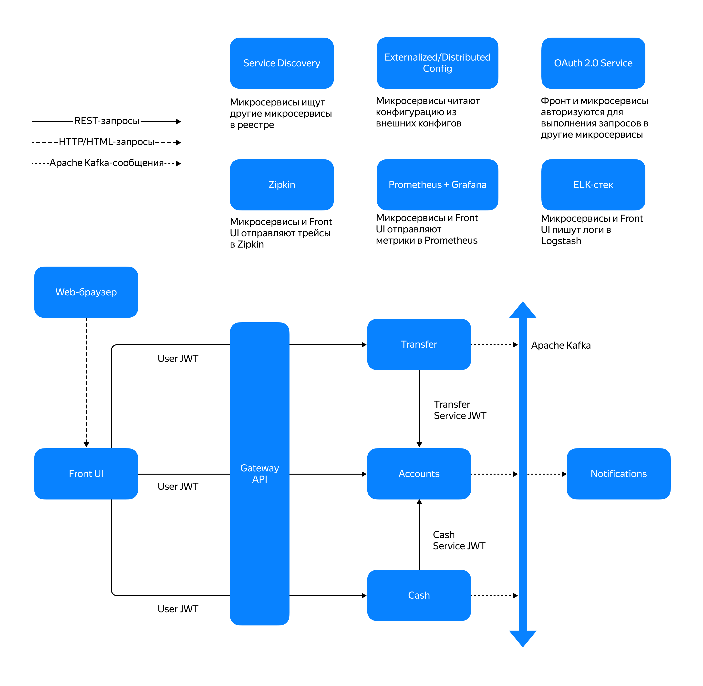

# Микросервисное приложение "Банк" 
## Развёртывание приложения с использованием Kubernetes, Helm



# Функциональность
## Микросервисное приложение «Банк» — это приложение с веб-интерфейсом, которое позволяет пользователю (клиенту банка):
- регистрироваться в системе по логину и паролю (заводить аккаунт);
- добавлять счета;
- класть виртуальные деньги на счёт и снимать их;
- переводить деньги между своими счетами;
- переводить деньги на другой счёт. 
## Приложение состоит из следующих микросервисов:

- Front UI (фронт);
  - Spring WebFlux;
  - Thymeleaf;
  - OAuth 2.0 (KeyCloak);
  - Spring Cloud Contract;
- Gateway API
  - Spring Cloud Gateway;
  - OAuth 2.0 (KeyCloak);
- Accounts (аккаунты со счетами);
  - Spring WebFlux REST;
  - Spring Data R2DBC;
  - Liquibase;
  - OAuth 2.0 (KeyCloak);
  - Spring Cloud Contract; 
- Cash (обналичивание денег);
  - Spring WebFlux REST;
  - Spring for Apache Kafka;
  - OAuth 2.0 (KeyCloak);
- Transfer (перевод между счетами одного или двух аккаунтов);
  - Spring WebFlux REST;
  - Spring for Apache Kafka;
  - OAuth 2.0 (KeyCloak);
- Notifications (уведомления)
  - Spring WebMVC;
  - Spring for Apache Kafka;
- трейсинг запросов с использованием системы распределённых трассировок Zipkin;
- мониторинги/графики метрик и алерты с использованием Prometheus и Grafana;
- логирование с использованием ELK-стека.

Для запуска проекта требуется среда разработки для сборки, Docker, Kubernetes, Helm, Elasticsearch.
(version.BuildInfo{Version:"v4.2.2", GitCommit:"b05881cf967a5a09e19866799d0edfd40675803a", GitTreeState:"clean", GoVersion:"go1.26.4", KubeClientVersion:"v1.36"})

1. Необходимо клонировать проект на локальный компьютер.
2. Зайти в папку 'my-bank-app'
3. Сменить ветку с 'main' на 'sprint_11'
4. Открыть проект в среде разработки
5. Соберём проект вместе с запуском тестов командой "gradle bootJar"
6. Находясь в директории 'my-bank-app', выполнить команду "docker buildx bake". Будут собраны имиджи всех модулей.
7. Находясь в директории 'my-bank-app', выполнить команду "kubectl create secret generic realm-secret --from-file=realm-export.json" . Для загрузки в Kubernetes файла с настройками Keycloak
8. Добавить в Helm библиотеки Codecentric и Bitnami командами:
    - 'helm repo add codecentric https://codecentric.github.io/helm-charts'
    - 'helm repo add bitnami https://charts.bitnami.com/bitnami'
    - 'helm repo add zipkin https://zipkin.io/zipkin-helm'
    - 'helm repo add kafka-repo https://helm-charts.itboon.top/kafka'
    - 'helm repo add prometheus-community https://prometheus-community.github.io/helm-charts'
    - 'helm repo add grafana https://grafana.github.io/helm-charts'
    - 'helm repo add elastic https://helm.elastic.co'
    - 'helm repo update' 
9. Находясь в директории 'my-bank-app', выполнить команду 'helm dependency build account-chart/' (возможно придется включить VPN)
10. Запустить проект командой 'helm install account-chart account-chart/' 
11. Для подключения к Grafana необходимо открыть порт командой 'kubectl port-forward service/account-chart-grafana-app 3000:80' 
12. Для входа в Grafana используйте логин и пароль из Secret `bank-app-secrets` (`grafana-admin-user` и `grafana-admin-password`).
13. Dashboard Grafana находится в папке grafana корневой директории проекта. Ее надо импортировать самостоятельно.
14. **Ввиду особенностей лицензирования Elasticsearch его надо запустить в отдельном контейнере. Для этого надо зайти в папку "/elk" и запустить docker-compose**
## Терминал немного зависнет (у меня на пару минут). Он будет ждать пока контейнер с liquibase выполнит свою работу.

Запуск занимает продолжительное время (особенно Keycloak). У меня на компьютере он занимает несколько минут. 
Следить за запуском проекта можно командой 'kubectl get pods'

## Приложение будет доступно по порту 8084.

Для запуска приложения необходимо перейти по адресу http://localhost:8084
Должно появиться окно авторизации keycloak. При первом запуске необходимо выбрать пункт "регистрация"
Ввести "Электронную почту" и пароль. Можно ввести любое валидное значение электронной почты.
Электронная почта будет являться логином для последующих авторизаций.

## В правом верхнем углу имеется кнопка выхода из аккаунта.
Можно выйти и зарегистрироваться под другим аккаунтом.

## Сервис уведомлений отправляет сообщения в свой лог.

Дополнения:
 - Keycloak работает со встроенной базой H2, поэтому после перезагрузки проекта учетные данные пропадают.
 - Helm-чарты для микросервисов оформлены в виде сабчартов, объединённых под один общий зонтичный Helm-чарт. Настройки чартов вынесены в зонтичный values.yaml

## Kubernetes Secrets для паролей

Перед установкой создайте Secret `bank-app-secrets` в том же namespace, куда устанавливается Helm-релиз. В нём должны быть ключи:

- `postgres-password` — пароль администратора PostgreSQL;
- `database-password` — пароль пользователя приложения `user1` в PostgreSQL;
- `account-client-secret`, `cash-client-secret`, `transfer-client-secret` — секреты OAuth-клиентов;
- `keycloak-admin-password` — пароль администратора Keycloak;
- `grafana-admin-user`, `grafana-admin-password` — логин и пароль Grafana.

Для локального запуска в namespace `default` создайте Secret из локального env-файла, содержащего эти пары `ключ=значение`. Не добавляйте этот файл в репозиторий:

```powershell
kubectl create secret generic bank-app-secrets --from-env-file=bank-secrets.env
kubectl create secret generic realm-secret --from-file=realm-export.json
helm upgrade --install account-chart .\account-chart
```

Для облачного namespace, например `bank`, сначала создайте namespace, затем создайте оба Secret с параметром `--namespace bank` и установите чарт с `--namespace bank`. Значения Secret должны соответствовать паролям/секретам, настроенным в PostgreSQL и Keycloak. Если PostgreSQL уже использует существующий persistent volume, смена Secret сама по себе не меняет пароль в базе.
 
